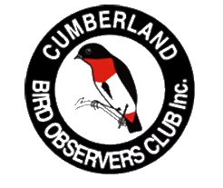

::: hero-section2
:::

::: {style="background: linear-gradient(135deg, #d97706 0%, #b91c1c 100%); color: white; padding: 2rem; border-radius: 8px; margin: 2rem 0;"}
**PROJECT & OBJECTIVES**

Currently a PhD candidate at the Center for Conservation Science, University of Newcastle, I focus on movement and spatial ecology from resident shorebirds and migratory species on their non-breeding ground, in Australia within the Hunter and Port Stephen estuaries. Shorebirds have complex behavioural and ecological needs which remain poorly understood at the level needed to inform regional land management decisions and ground-level protection in Australia.

This Research Project (PhD) intends to understand how local shorebirds use habitats for roosting and foraging, as it is crucial to inform stakeholders and land managers for effective conservation of both resident and migratory species.
:::

::: {style="background: linear-gradient(135deg, rgba(220,110,100,0.95), rgba(200,90,80,0.95)); color: white; padding: 2rem; border-radius: 12px; box-shadow: 0 6px 12px rgba(0,0,0,0.3); margin-bottom: 1.5rem; border-left: 5px solid #e68a7a;"}
**Chapter 1: Are shorebirds estuary loyal and do they show site preferences? Where do they forage and roost at night and during low tide?**

*Hypothesis: Birds are expected to show estuary fidelity and tide-driven site preferences, using VHF Motus presence data from VHF tagged birds and descriptive analysis.*

A local automated telemetry array is deployed across the Hunter (eight VHF stations) and Port Stephens (three VHF stations) estuaries, combining omnidirectional and directional antennas that listen continuously for signals from individually coded nanotags (\<4 g) attached to shorebirds captured at known roosting sites. These tags offer a low-impact and low-cost option for long-term population monitoring. Since 2021, individuals are tagged across several species. Detection patterns across tidal and circadian cycles let us examine movement and site selection over time.

Early results confirm estuary loyalty for most of the species (average 70% daily detection within the same estuary) and show tide- and diel-dependent site selection that varies by species. However, over half of detections occurred during daylight, reflecting station placement at diurnal roosts and leaving nocturnal and low-tide movements poorly understood. Using satellite data from GPS-tagged shorebirds should guide future station placement to address this main limitation, improving our understanding and long-term monitoring.
:::

::: {style="background: linear-gradient(135deg, rgba(220,110,100,0.95), rgba(200,90,80,0.95)); color: white; padding: 2rem; border-radius: 12px; box-shadow: 0 6px 12px rgba(0,0,0,0.3); margin-bottom: 1.5rem; border-left: 5px solid #e68a7a;"}
**Chapter** **2: Are shorebirds evenly partitioning their behavior within the estuary? Are the different sites providing the same functional role for all species?**

*Hypothesis*: *Shorebirds are expected to use distinct sites to forage and roost, using GPS-accelerometer data from devices equipped on birds and automated behavioral classification models. Resident species might show overlapping foraging and roosting sites, while migratory species may separate these activities.*

Motus technology reveals shorebird movement and site selection but cannot explain why a site is chosen: what activity occurs there, and when? Direct diurnal observations, mostly happening at high tide, show shorebirds foraging and roosting at distinct sites. Yet, this hasn't never been confirmed whether it is true during the night or at low tide. Using combined GPS/accelerometer and video technologies will allow to assess birds behavior 24/7, and reveal activity patterns across species and the full behavioral cycle (day/night, low/high tide).
:::

::: {style="background: linear-gradient(135deg, rgba(220,110,100,0.95), rgba(200,90,80,0.95)); color: white; padding: 2rem; border-radius: 12px; box-shadow: 0 6px 12px rgba(0,0,0,0.3); margin-bottom: 1.5rem; border-left: 5px solid #e68a7a;"}
**Chapter 3: How the foraging and roosting areas for shorebirds evolved during the last decade in Australia? And how do they shape their demography?**

*Hypothesis: Foraging areas are expected to mostly drive shorebird demography, implementing models which include Geographic Information System data from Digital Earth Australia and bird abundance data from BirdLife Australia.*

Using a recently released intertidal spatial layer ([DEA Intertidal](https://www.ga.gov.au/scientific-topics/dea/dea-data-and-products/dea-intertidal)), we will accurately examine the extent and distribution of shorebird foraging areas (e.g., mudflats) since 2016. This dataset provides an annual, high-resolution elevation product combined with tide modelling, enabling precise mapping of exposed and flooded areas over time. We will also use Supratidal and Coastal Lowland Forest spatial layer ([SCLF](https://openresearch.newcastle.edu.au/articles/dataset/National_Supratidal_and_Coastal_Lowland_Forest_extent_map_of_Australia/29755589)), combined with additional datasets on supratidal habitat, coastal ecosystems, and land cover to extract roosting areas (e.g., islets, sandy shores). Both foraging and roosting outputs will serve as dynamic variables in a longitudinal, multi-species model testing which most strongly drives shorebird demography. Demographic data ([Bird Life Australia](https://birdlife.org.au/)) will come from standardised abundance surveys.

This work provides a continental-scale analysis linking habitat evolution to population dynamics, informing coastal management and conservation under sea level rise.
:::

::: {style="background: linear-gradient(135deg, rgba(220,110,100,0.95), rgba(200,90,80,0.95)); color: white; padding: 2rem; border-radius: 12px; box-shadow: 0 6px 12px rgba(0,0,0,0.3); margin-bottom: 1.5rem; border-left: 5px solid #e68a7a;"}
**Chapter 4: Are shorebirds showing segregating or overlapping foraging niche during the non-breeding season?**

*Birds are expected to show segregated foraging niches, using a multi-species carbon, nitrogen, and sulphur stable isotope analysis based on vegetation samples from the study areas and blood samples from trapped shorebirds.*

Carbon and nitrogen isotopes trace habitat use and trophic position, while sulfur isotopes help resolve the limitations of carbon alone, given strong terrestrial-marine sulfur contrasts, making them a useful additional tracer of estuarine habitat use. Blood samples from multiple species, collected post-arrival, and vegetation samples across habitats allows to characterise population-level trophic niches across the non-breeding season. Crucially, this approach captures both the direct foraging habitats birds use and the indirect habitats supporting their prey, revealing the trophic sources shorebirds depend on and which habitats should be prioritised for conservation.
:::

::: {style="background: linear-gradient(135deg, rgba(220,110,100,0.95), rgba(200,90,80,0.95)); color: white; padding: 2rem; border-radius: 12px; box-shadow: 0 6px 12px rgba(0,0,0,0.3); margin-bottom: 1.5rem; border-left: 5px solid #e68a7a;"}
**Chapter 5** (bonus)**: Are risks from pest predators shaping movements of native shorebirds?**

*Predators and shorebirds home ranges are expected to not overlap in time, using satellite tracking data from tagged individuals from both groups.*

Tidal cycles primarily drive shorebird movements between foraging and roosting sites, but diel cycles introduce an additional asynchroned constraint since most mammalian predators are nocturnally active, and potentially also shaping shorebirds site selection. Invasive European red foxes threaten Hunter estuary shorebirds. GPS tracking offers an efficient method to assess individual trajectories, home ranges, and spatial utilisation distribution for both predators and preys. Analysing spatio-temporal overlaps relative to tidal cycles, land-cover, and inter-tidal exposure can quantify predation risk and identify potential refuges for shorebirds.
:::

:::: {style="background: linear-gradient(135deg, rgba(120,140,160,0.95), rgba(100,120,140,0.95)); color: white; padding: 3rem 2rem; border-radius: 12px; box-shadow: 0 8px 16px rgba(0,0,0,0.3); margin-bottom: 2rem; max-width: 1200px; margin-left: auto; margin-right: auto;"}
**FOUNDERS & COLLABORATORS**

-   **The PhD program is generously donor-funded by Ms Margaret Flynn.**

-   The Research Project is funded by many institutions that may also collaborate with us as the Hunter Local Land Services, Hunter Bird Observers Club, Department of Planning and Environment, National Parks and Wildlife Services, Wettenhall Environment Trust, Bird Life Australia, Australian and Pacific Science Foundation, Cumberland Birds Observers Club, Digital Earth Australia, and Griffith University.

::: {style="display: flex; justify-content: center; align-items: center; flex-wrap: wrap; gap: 2rem; margin: 2rem auto 0; padding: 2rem; background: white; border-radius: 50px; box-shadow: 0 20px 40px rgba(0,0,0,0.15); max-width: 1200px;"}
{style="height: 60px; width: auto; filter: brightness(1.1);"} {style="height: 60px; width: auto; filter: brightness(1.1);"} {style="height: 60px; width: auto; filter: brightness(1.1);"} {style="height: 60px; width: auto; filter: brightness(1.1);"} {style="height: 60px; width: auto; filter: brightness(1.1);"} {style="height: 60px; width: auto; filter: brightness(1.1);"} {style="height: 60px; width: auto; filter: brightness(1.1);"} {style="height: 60px; width: auto; filter: brightness(1.1);"} {style="height: 60px; width: auto; filter: brightness(1.1);"} {style="height: 60px; width: auto; filter: brightness(1.1);"}
:::
::::

::: {style="background: linear-gradient(135deg, rgba(40,40,40,0.95), rgba(25,25,25,0.95)); color: white; padding: 3rem 2rem; border-radius: 12px; box-shadow: 0 8px 16px rgba(0,0,0,0.3); margin-bottom: 2rem; max-width: 1200px; margin-left: auto; margin-right: auto;"}
**JUSTE UN MOT ...**

*I am from France and a curious man, interested on movement and spatial ecology of wildlife and population demographics.*

*My attention is caught by animal interactions, behaviours, choices, and I hope to participate at generating useful datasets, easy to read and implement, so it can inform conservation action while considering socio-economic and ecological priorities.*
:::


::: {style="background: linear-gradient(135deg, rgba(120,120,120,0.95), rgba(25,25,25,0.95)); color: white; padding: 3rem 2rem; border-radius: 12px; box-shadow: 0 8px 16px rgba(0,0,0,0.3); margin-bottom: 2rem; max-width: 1200px; margin-left: auto; margin-right: auto;"}

**Progress (16 November 2026)**

```{r, message = FALSE, warning = FALSE, echo = FALSE, fig.align = 'center'}

#| label: radar-charts
#| echo: false
#| message: false
#| warning: false
#| fig-width: 6.8
#| fig-height: 8.9
#| fig-align: center

library(dplyr)

# ---- Palette -----------------------------------------------------------------
COL_HIGH <- "#2FA36B"
COL_MID  <- "#F2A541"
COL_LOW  <- "#E04F5F"
COL_BG   <- "white"
INK      <- "#1F2937"   # main text
MUTED    <- "#6B7280"   # secondary text
FAINT    <- "#9AA3B2"   # overlines

# Status badge colours (fill and text)
status_fill <- c(
  "Submitted"        = "#2FA36B",   # green
  "Published"        = "#E0A100",   # gold
  "Drafted"          = "#2FA36B",   # silver blue
  "Work in progress" = "#A9BFD6"    # grey
)
status_text <- c(
  "Submitted"        = "white",
  "Published"        = "gold",
  "Drafted"          = "#2B2B2B",
  "Work in progress" = "white"
)

# ---- Data --------------------------------------------------------------------
df <- data.frame(
  chapter                    = 1:5,
  acquired_data              = c(5, 2, 5, 4, 0),
  ethics_approvement         = c(5, 5, 5, 5, 2),
  legal_approvement          = c(5, 5, 5, 5, 2),
  safety_approvement         = c(5, 5, 5, 5, 1),
  fundings                   = c(5, 5, 5, 0, 5),
  data_collection_confidence = c(5, 3, 5, 5, 2),
  delivery_date              = c(2026, 2027, 2027, 2028, 2028),
  # EDIT: "Submitted", "Published", "Drafted" or "Work in progress"
  status                     = c("Drafted",           # ch 1
                                 "Work in progress",  # ch 2
                                 "Work in progress",  # ch 3
                                 "Work in progress",  # ch 4
                                 "Work in progress")  # ch 5
) %>%
  mutate(rate = rowMeans(across(acquired_data:data_collection_confidence)))

stopifnot(all(df$status %in% names(status_fill)))

# ---- Editable labels ---------------------------------------------------------
chart_titles <- c(
  "Movements and site use",
  "Behaviour classification",
  "Habitat distribution",
  "Foraging niche partitioning",
  "Predation risk"
)

# "\n" = manual line break (drawn as is, no automatic wrapping)
chart_desc <- c(
  "VHF data (Motus) reveals site preference\ndepending tide and circadian cycles",
  "GPS-accelerometer data (Druid) identifies\nbehaviours depending space and time",
  "Remote-sensing data (DEA) maps\nAustralian shorebirds habitats since 2016",
  "Stable isotopes (δ13C, δ15N, δ34S)\ntrace basal source of foraging habitats",
  "Pest predator (Vulpes vulpes) shapes\nshorebird movements in space and time"
)

chart_collab <- c(
  "",
  "",
  "Digital Earth Australia",
  "Griffith University",
  "NSW DCCEEW"
)

var_labels <- c(
  "Acquired\ndata", "Ethics", "Legal", "Safety", "Funding",
  "Data\ncollection\nconfidence"
)

vars <- c("acquired_data", "ethics_approvement", "legal_approvement",
          "safety_approvement", "fundings", "data_collection_confidence")

# ---- Helpers -----------------------------------------------------------------
rate_colour <- function(x) if (x >= 4) COL_HIGH else if (x >= 2) COL_MID else COL_LOW
rate_label  <- function(x) if (x >= 4) "High"   else if (x >= 2) "Moderate" else "Low"

spaced <- function(s) paste(strsplit(toupper(s), "")[[1]], collapse = " ")

# Rounded rectangle (also makes pills when r = half the height)
rrect <- function(x0, y0, x1, y1, r, col = NA, border = NA, lwd = 1) {
  arc <- function(cx, cy, a0, a1) {
    t <- seq(a0, a1, length.out = 14)
    cbind(cx + r * cos(t), cy + r * sin(t))
  }
  p <- rbind(arc(x1 - r, y1 - r, 0,           pi / 2),
             arc(x0 + r, y1 - r, pi / 2,      pi),
             arc(x0 + r, y0 + r, pi,          3 * pi / 2),
             arc(x1 - r, y0 + r, 3 * pi / 2,  2 * pi))
  polygon(p[, 1], p[, 2], col = col, border = border, lwd = lwd)
}

circ <- function(x, y, r, col = NA, border = NA, lwd = 1) {
  t <- seq(0, 2 * pi, length.out = 60)
  polygon(x + r * cos(t), y + r * sin(t), col = col, border = border, lwd = lwd)
}

draw_chart <- function(i) {
  rate <- df$rate[i]
  rc   <- rate_colour(rate)
  vals <- as.numeric(df[i, vars])
  st   <- df$status[i]

  par(mar = c(0, 0, 0, 0), bg = COL_BG, family = "sans", xpd = NA)
  plot.new()
  plot.window(xlim = c(-1.7, 1.7), ylim = c(-2.3, 2.15), asp = 1)

  xl <- -1.52   # left content edge
  xr <-  1.52   # right content edge

  # ---- Card ----
  rrect(-1.68, -2.26, 1.68, 2.12, r = 0.10, col = "#FBFCFD", border = "#E5E9F0", lwd = 1.5)

  # ---- Header ----
  rect(xl, 2.04, xl + 0.16, 2.06, col = rc, border = NA)                  # accent dash
  text(xl, 1.93, spaced(paste("Chapter", df$chapter[i])),
       adj = c(0, 0.5), cex = 0.62, font = 2, col = FAINT)
  text(xl, 1.75, chart_titles[i], adj = c(0, 0.5), cex = 1.3, font = 2, col = INK)
  text(xl, 1.60, chart_desc[i], adj = c(0, 1), cex = 0.74, col = MUTED)
  if (nzchar(chart_collab[i])) {
    text(xl, 1.19, paste("Collaboration:", chart_collab[i]),
         adj = c(0, 0.5), cex = 0.68, font = 3, col = FAINT)
  }

  # ---- Status badge (top right) ----
  lab <- toupper(st)
  w   <- strwidth(lab, cex = 0.66, font = 2)
  bx0 <- xr - (w + 0.32)
  rrect(bx0, 1.855, xr, 2.005, r = 0.075, col = status_fill[[st]])
  circ(bx0 + 0.10, 1.93, 0.024, col = status_text[[st]])
  text(bx0 + 0.19, 1.93, lab, adj = c(0, 0.5), cex = 0.66, font = 2, col = status_text[[st]])

  segments(xl, 1.06, xr, 1.06, col = "#E8ECF2", lwd = 1)

  # ---- Radar geometry ----
  cy  <- -0.30
  R   <- 0.82                                   # radar size
  ang <- pi / 2 - (0:5) * 2 * pi / 6
  ring <- function(k) cbind(R * cos(ang) * k / 5, cy + R * sin(ang) * k / 5)

  polygon(ring(5), col = "#F3F6FA", border = "#D5DBE5", lwd = 1.4)
  for (k in 1:4) polygon(ring(k), col = NA, border = "#DDE3EC", lty = 3, lwd = 1)
  segments(0, cy, R * cos(ang), cy + R * sin(ang), col = "#E1E6EE", lwd = 1)

  # Data shape
  pd <- cbind(R * cos(ang) * vals / 5, cy + R * sin(ang) * vals / 5)
  polygon(pd, col = adjustcolor(rc, alpha.f = 0.22), border = rc, lwd = 3)

  # Score bubbles at each vertex
  for (j in 1:6) {
    circ(pd[j, 1], pd[j, 2], 0.075, col = "white", border = rc, lwd = 2.5)
    text(pd[j, 1], pd[j, 2], format(vals[j]), cex = 0.62, font = 2, col = INK)
  }

  # Axis labels
  ca <- cos(ang); sa <- sin(ang)
  adjx <- ifelse(abs(ca) < 0.1, 0.5, ifelse(ca > 0, 0, 1))
  adjy <- ifelse(sa > 0.9, 0, ifelse(sa < -0.9, 1, 0.5))
  for (j in 1:6) {
    text(1.17 * R * ca[j], cy + 1.17 * R * sa[j], var_labels[j],
         adj = c(adjx[j], adjy[j]), cex = 0.72, font = 2, col = "#4B5563")
  }

  # ---- Score block ----
  segments(xl, -1.56, xr, -1.56, col = "#E8ECF2", lwd = 1)

  text(xl, -1.68, spaced("Feasibility"), adj = c(0, 0.5), cex = 0.58, font = 2, col = FAINT)
  text(xr, -1.68, spaced("Target delivery"), adj = c(1, 0.5), cex = 0.58, font = 2, col = FAINT)

  score <- sprintf("%.1f", rate)
  text(xl, -1.89, score, adj = c(0, 0.5), cex = 2.4, font = 2, col = rc)
  sx <- xl + strwidth(score, cex = 2.4, font = 2) + 0.04
  text(sx, -1.91, "/5", adj = c(0, 0.5), cex = 1.1, col = FAINT)
  cx0 <- sx + strwidth("/5", cex = 1.1) + 0.10
  rl  <- toupper(rate_label(rate))
  cw  <- strwidth(rl, cex = 0.6, font = 2) + 0.18
  rrect(cx0, -1.955, cx0 + cw, -1.825, r = 0.065, col = rc)
  text(cx0 + cw / 2, -1.89, rl, cex = 0.6, font = 2, col = "white")

  text(xr, -1.89, df$delivery_date[i], adj = c(1, 0.5), cex = 1.5, font = 2, col = INK)

  # Progress bar
  rrect(xl, -2.145, xr, -2.095, r = 0.025, col = "#E6EAF0")
  fw <- max((xr - xl) * rate / 5, 0.05)
  rrect(xl, -2.145, xl + fw, -2.095, r = 0.025, col = rc)
}

# ---- Print each diagram, one after the other ----------------------------------
for (i in seq_len(nrow(df))) {
  draw_chart(i)
}
```

:::
